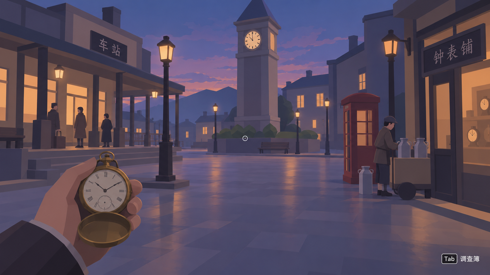
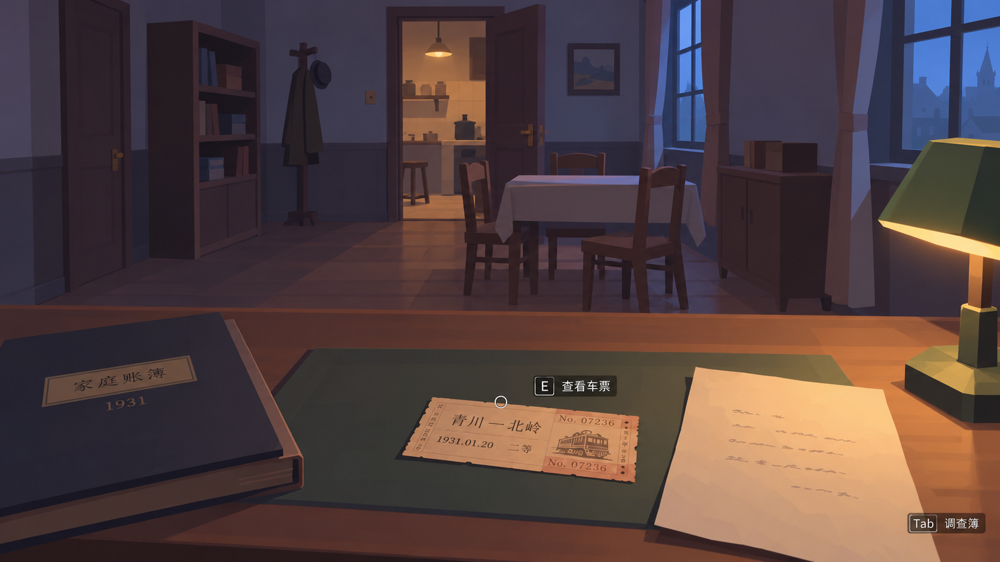
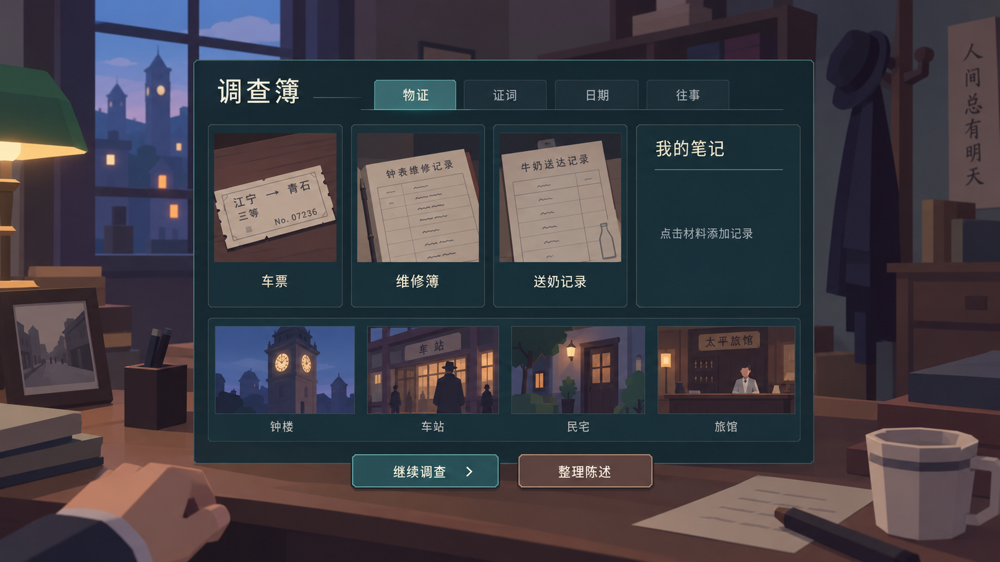

# 错日证词 3D Demo企划

第一人称悬疑调查。1931 年小镇可自由步行，进入建筑时黑屏转场，室内是完整的独立 3D 场景。玩家靠观察、核对证词和重排往事，决定是否提交真实材料。

图 1 小镇探索概念图。模块建筑、简化人物与暖冷灯光形成主要画面。

以上为低模风格概念 Demo 图，用于确定制作目标，非实机截图。

### 首个Demo范围

目标约 20 至 30 分钟：一个小镇外景、车站、钟表铺和住宅，约五名 NPC、8 至 10 件线索。先让玩家比较街钟与怀表、检查车票，再形成对不在场陈述的质疑。

### 画风与制作范围

沿用参考图的简化人物和柔和色块：灰蓝、紫灰暗部搭配暖黄灯光。建筑由少量墙体、门窗模块组合；家具使用简单网格和平涂材质，装饰主要依靠贴图。

NPC 共用骨架，以发型和服装区分，先做待机与交谈动作。只把票孔、钟面和日期等推理相关细节做清楚。

## 室内调查与推理

每间屋子可完整观察和走动。桌面、门窗、人物位置共同提供信息；重要材料支持放大与反复查看。

图 2 住宅调查概念图。少量家具与关键证物承担探索内容。

### 交互与转场

WASD 行走，鼠标观察，E 检查与交谈，Tab 打开调查簿。门前互动 → 淡出并保存 → 加载室内 → 恢复状态 → 淡入；离开时返回同一门口。

### 核心推理

| 材料 | 玩家需要判断的关系 |
| --- | --- |
| 完整车票与旅馆登记 | 买票及短暂停留，能否证明整个傍晚都在外？ |
| 街钟、怀表与送奶记录 | 证词中的时刻来自哪只钟，如何交叉核实？ |
| 问路、电话与原始记录 | 日期及先后顺序是否支持当事人的说法？ |

律师只协助核实材料。对话采用固定分支，往事片段允许玩家重排；提交给警方的仍是票据、簿页和证言。

完整首章再补邻居家、警署、修车铺和旅馆，并接入诚实提交与知情隐瞒两个结局。开工前统一保单年限、煤车声时序和结局中的证据状态。

## 调查簿与代理开发

调查簿保留材料来源和玩家笔记，往事用于回看与排序。界面不自动标出凶手或真假线索。

图 3 调查簿概念图。简洁面板和材料卡片保持信息可读。

### 应用与自动化

| 应用 | 减少人工的方式 |
| --- | --- |
| Unity 6.3 与 URP | Editor 脚本生成场景和 Prefab，自动测试、构建与截图。 |
| Blender 5.2 | Python 批量制作模块与道具，共用骨架，导出 FBX。 |
| ImageGen | 提供风格图、纹理与装饰；模型和可读证物正文分别制作。 |
| 编码代理、agy 与 Git | 代理实现与复核，agy 做批量草稿；Git 保存通过检查的阶段。 |

### Skills outline

现有：imagegen、pdf、computer-use、skill-creator。待建四个项目技能：剧情数据校验、Unity 场景生产、Blender 资产生产、调查玩法回归。

工作流：修改 → 数据校验 → 编译与测试 → 实际运行截图 → 修正。人工集中审核画风、谜题公平性和结尾体验。

[三页图文 PDF](../output/pdf/first-person-3d-plan.pdf) · [图片提示词](concepts/generation-notes.json)
