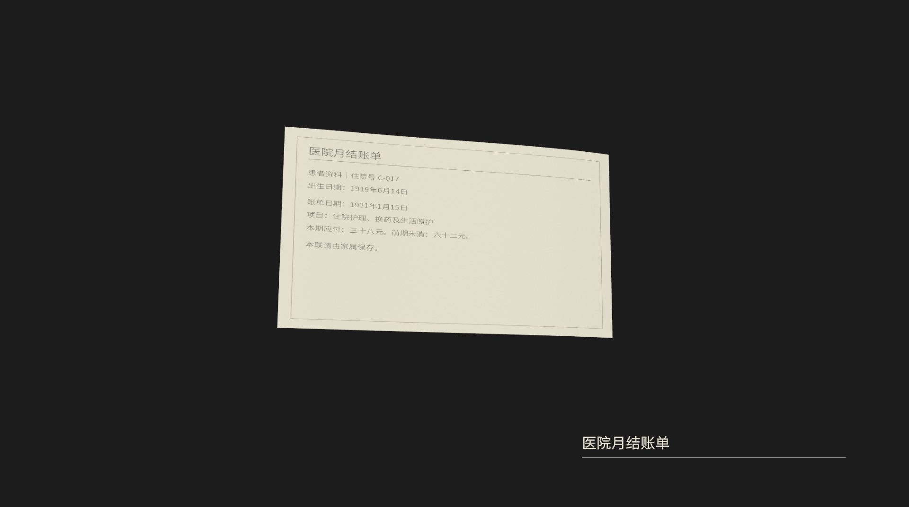
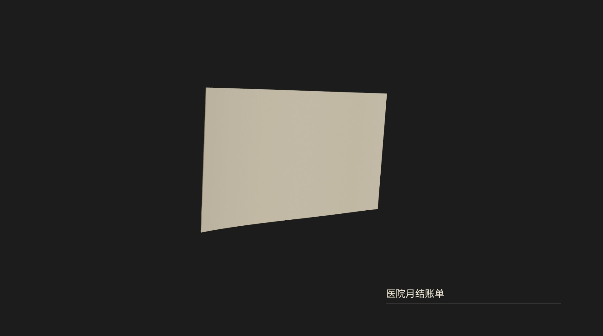
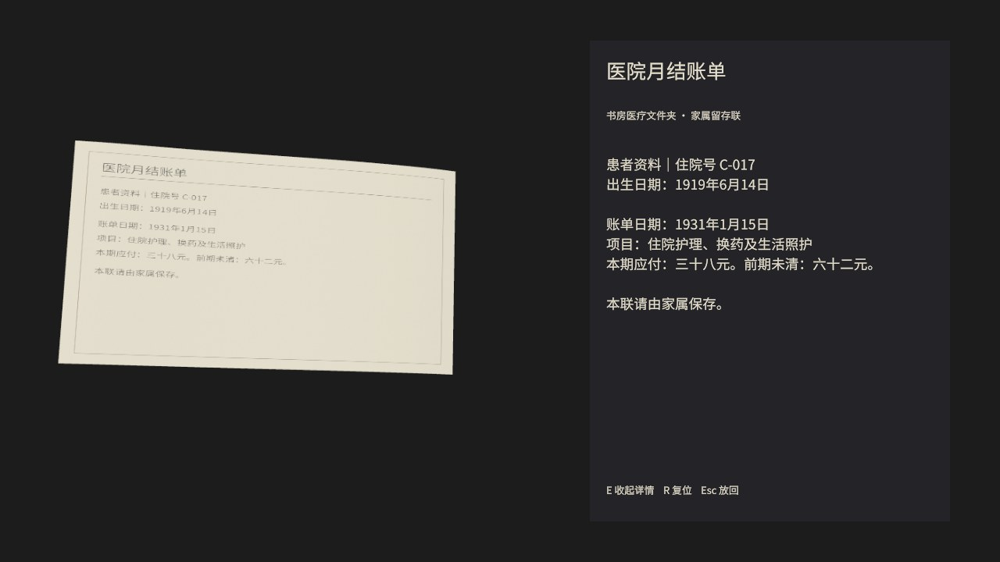
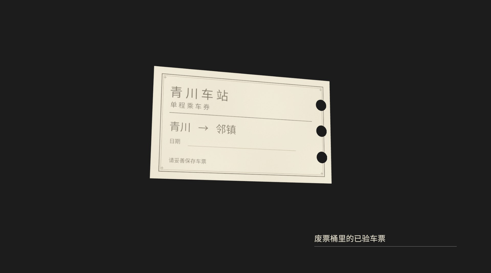
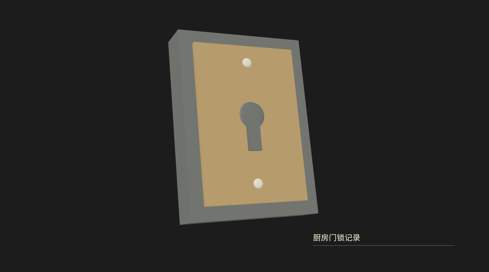

# 实物检查：重制版参考

用户确认以《生化危机3：重制版》的物品检查为参考。对照[实际检查画面](https://www.gamepressure.com/resident-evil-3-remake/gfx/word/136685296.jpg)，使用暗背景、立体物件和右下名称；维持本项目原模型与内容。

左键拖动旋转，滚轮缩放，R复位，E展开/收起详细内容，Esc放回。初始只有名称；阅读时世界时间继续、人物停止移动。已更新原桌面“错日证词-新版”，正常存档保持。

4秒原速实机翻转视频保留在本地 `builds/house-review/push-source-media-20261013/evidence-inspection/证据检查-纸张翻转.mp4`；按仓库体积规范不提交录像，来源及参数见 recording-provenance.json。

最终版通过1080/720物品检查、完整住宅与独立进程读档四次原生验收；普通抽屉射线与物品原位/原材质保持，旋转/缩放/复位/E使用共享输入处理函数。非物理键鼠或盲测，未重跑全镇/车辆/铁路/Windows套件。确切版本与范围见[验收记录](acceptance.json)，视频没有加速、补帧动画或配音。

仓库仅保留 JPG 关键帧；本轮全部原始 PNG／录像在本地 `builds/house-review/push-source-media-20261013/evidence-inspection/`，不随 Git 分发。原验证版本和结果不变。
