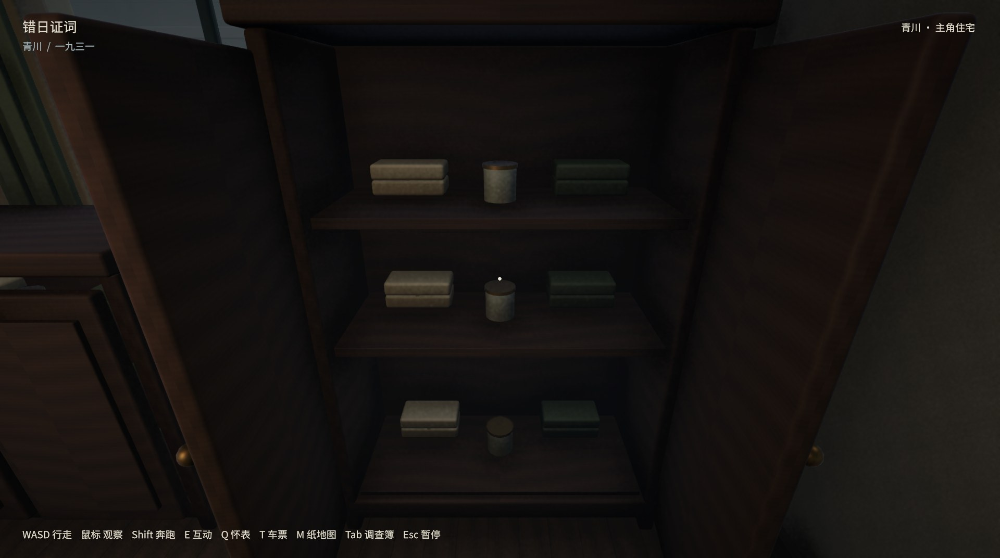
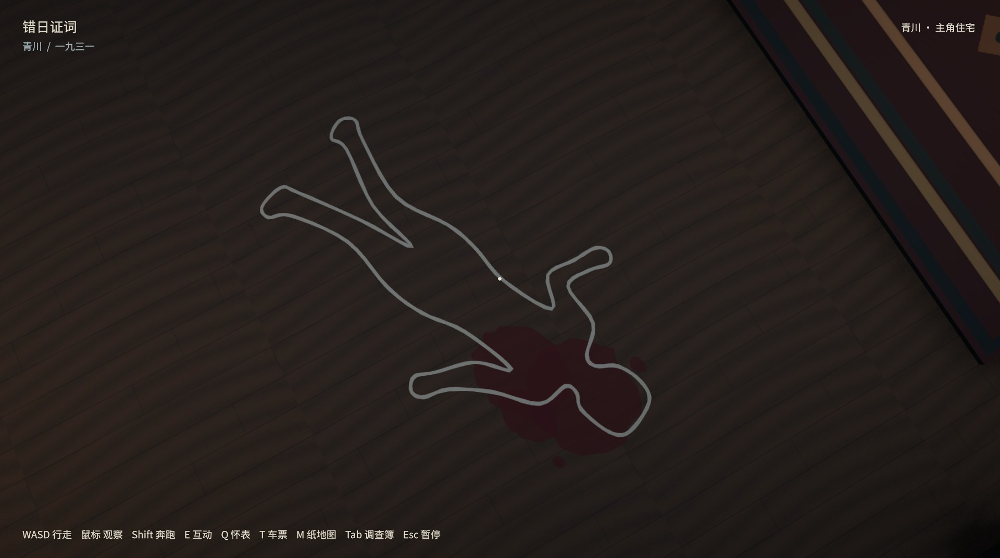

# 住宅摆放与实物证据修复

已更新原桌面“错日证词-新版”入口，保留旧应用备份和正常存档。

- 修正书房/厨房柜体相交、家具方向、桌腿/桌上物件高度、楼梯扶手和悬空墙线。
- 重做柜体内壳、抽屉底板/侧板，20组柜格补盒子、布料和瓶罐；把手随门轴运动，开合避让玩家。
- 白线改为约1.68米成年女性轮廓，头肩附近有深红血迹；警戒布带连接立桩并留入口。
- E打开柜子，对准实体证据按E观察；先显示可旋转的模型和名称，再按E展开详情。左键拖动、滚轮缩放、Esc放回。

## 实机画面

[柜格1—10](contact-final-0.jpg) · [柜格11—20](contact-final-1.jpg) · [楼梯和实体证据](contact-final-2.jpg)

新版纸张观察与详细阅读见[实物检查](../evidence-inspection/README.md)。

## 验证范围

同一Mac程序集通过81项EditMode检查、1080p/720p原生住宅检查及独立重启读档。逐柜检查实际射线选取，逐张审看20柜打开画面，实际控制器完成进屋、8室通行、上下楼和前后门往返。柜门碰撞检查覆盖5个开合姿态，不代表所有角度零穿插；密码、详情和拼信使用相同输入处理函数，非物理键鼠或盲测。未重跑全镇、车辆、列车和Windows套件。原剧情道路时窗结论未改。

用户临时视频路径被macOS拒绝读取，因此按明确文字需求实现，未宣称逐帧还原视频。最终散列、保存检查和日志位置见[验收记录](acceptance.json)。

仓库仅保留 JPG 关键帧；本轮全部原始 PNG／录像在本地 `builds/house-review/push-source-media-20261013/house-corrections/`，不随 Git 分发。原验证版本和结果不变。
