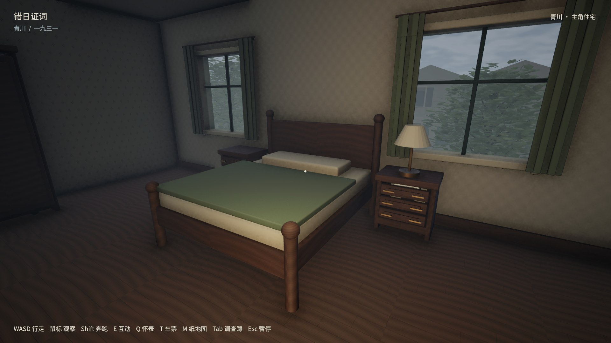
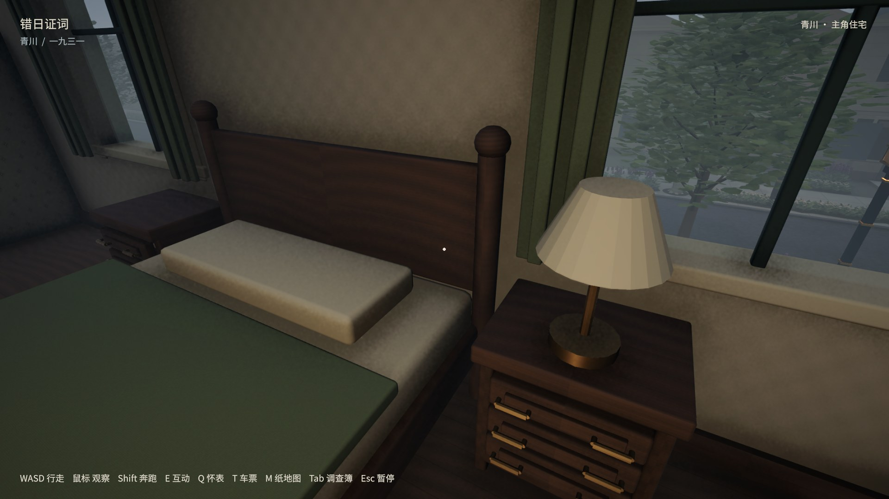
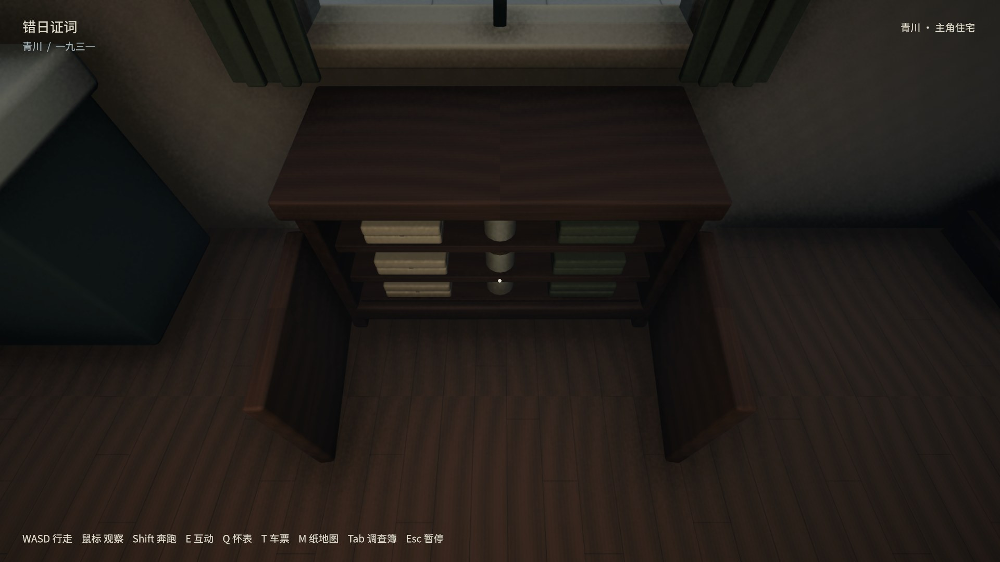

# 住宅摆放自查与修正 · HOUSE-04

已更新原桌面「错日证词-新版」入口。此次保留原调查进度、3D证据观察和房屋门窗结构。

| 范围 | 已修正 |
| --- | --- |
| 夫妻卧室 | 床头改靠两窗之间的实墙，后缘距踢脚线约3.8cm；两床头柜贴近床侧并靠墙，台灯避开窗帘；梳妆台移至西侧实墙，衣柜保留正面开合空间。 |
| 孩子卧室 | 床头靠墙，床头柜随床定位，书桌、椅子、纸张使用对应位置，玩具柜靠内墙。 |
| 书房 | 书桌及桌上灯/来信一起靠墙；书柜内每册书落到层板；文具柜移至东墙，避免开启的房门挡在正面。 |
| 厨房 | 高柜移至北墙实墙，西窗下改矮柜，水槽和炉具靠墙；矮柜物件前移到层板可见区域。 |
| 会客室 | 沙发、茶几和地毯重新组合；侧柜及其灯、茶杯、文件移至东侧实墙，避开窗帘。 |
| 杂务房 | 洗衣台及桶、叠布同步靠后墙；杂物柜避开侧窗。 |
| 浴室 | 浴缸、盆座靠墙，脚底落地；壁柜去除悬空的落地柜脚并加入墙面支撑。 |
| 缝纫储物房 | 缝纫桌及机身靠墙并配椅子；床单柜、旧衣箱重新排列，保留开合区域。 |

前次只通过柜门扫掠和通行检查，未覆盖家具组合、床后间距、窗帘和房门遮挡，不能作为摆放美术合格证明。这次加入源模型30处靠墙、38件落地、6组桌面承托、固定家具之间及窗帘交叠检查；脚、桌腿等修正在Blender源中完成，删除旧的导入时临时拉长补丁。

实机复查发现文具柜被房门遮挡、低柜物品藏得过深，继续修正后再次验证。最终Mac/Metal构建完成83/83编辑器测试、20组柜子正常射线开合与储存纸张查看、连续八室与楼梯行走、0614保险柜、独立进程读档及前后门往返。31个站立视点在1080p/720p拍摄；720p另复查3D模型旋转、缩放、E详情及退出恢复。截图为实际游戏画面。

旧存档若恰好位于移动后的家具内，载入时仅在同房间、同楼层搜索附近空位；原坐标可站立时保持不变。以这次报告位置调用实际避让方法，平移0.4米即可站稳；单独测试空旷、室外及楼梯位置不被改动。测试使用隔离存档，正常存档字节保持一致。

上述为程序驱动的原生渲染、真实角色碰撞和交互射线检查，不是物理键鼠或陌生玩家盲测，也没有重新进行全镇、车辆、Windows或低配性能验收。复核数值、程序集/模型摘要和每次测试结果见acceptance.json；原始图片与日志在builds/house-review/placement03-*。

复现：Blender运行tools/house/build_house.py、verify_source.py、audit_placement.py → Unity运行BuildSlice.BuildHouseStaging → tools/house/run_review.py分别使用默认、--reload、--placement、--storage、--evidence；--720切换分辨率。最后一次柜体微调同步修改生成源，并通过带前置源SHA校验的一次性模型迁移完成，脚本保留在忽略的builds/house-review/refine-cabinet-source.py，不能重复应用。

仓库仅保留 JPG 关键帧；本轮全部原始 PNG／录像在本地 `builds/house-review/push-source-media-20261013/house-placement/`，不随 Git 分发。原验证版本和结果不变。
