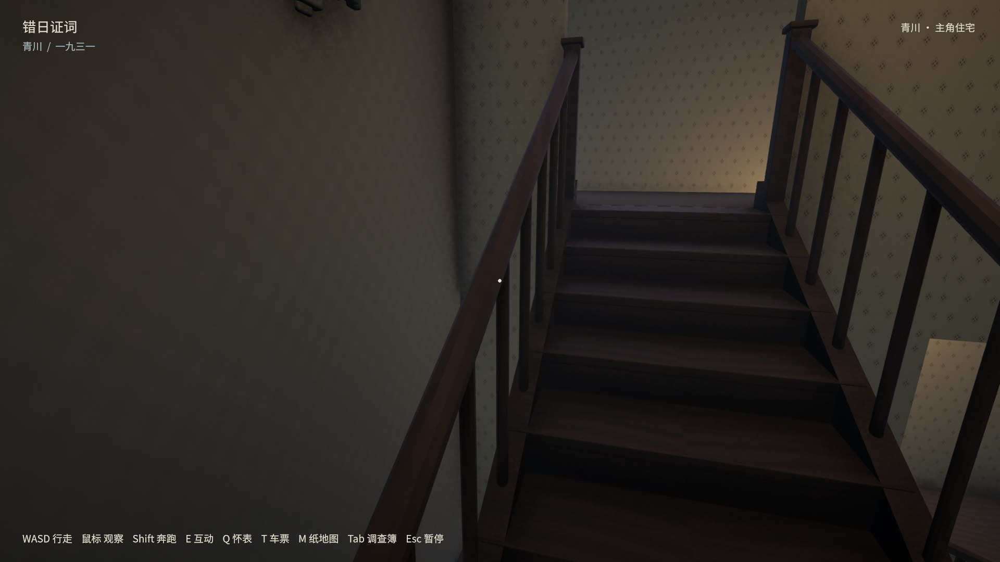
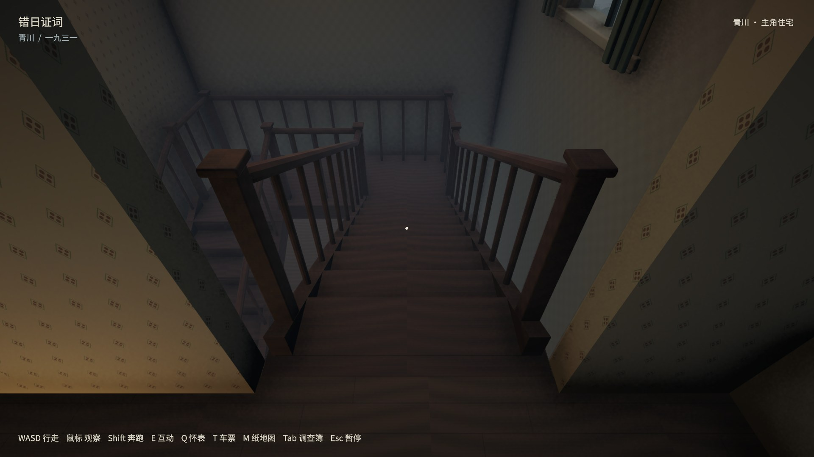
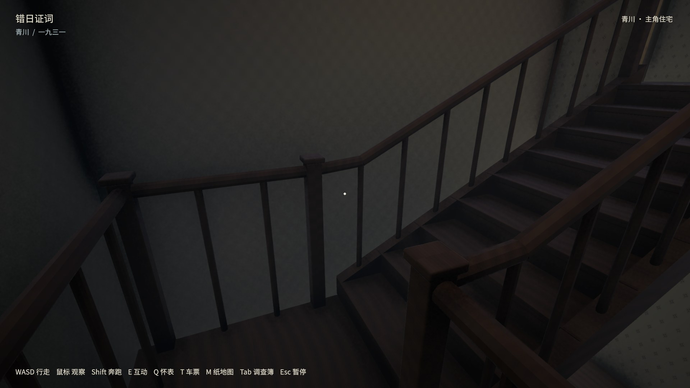
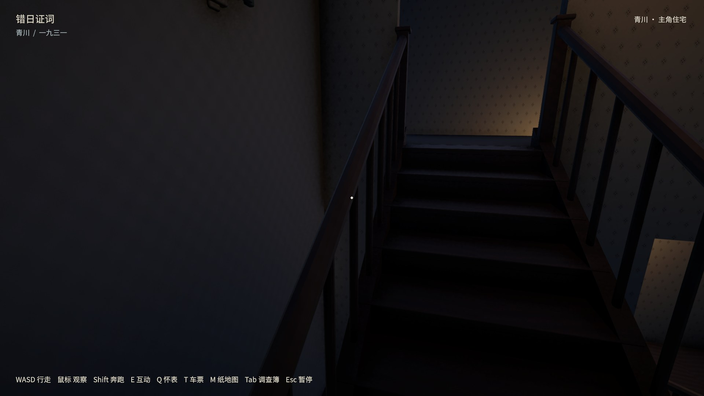

# 住宅楼梯修正 · 2026-10-13

截图中墙边孤立的深色块来自穿入室内的门外雨棚，横向黑缝来自两层隔墙之间未封闭的楼板带。两处均已从共用模型源修正。

- 雨棚内边界移至外墙外表面；楼梯间墙体连续跨过楼层交界。
- 补齐上端出口原有10cm地板缝，维持18级原高度与正常人物碰撞。
- 四条实木侧梁、端柱和连续扶手统一在Blender中制作，移除Unity里额外的转角补杆；中央楼梯井增加护栏。
- 门框立边与横梁留5mm接缝，消除转角重叠。

最终Mac包实测：中间／左右偏移24cm步行上下楼，居中奔跑往返；8处白天视角与3处夜间视角；20柜和所有柜内纸张、8室、保险柜、拼信、住宅两门及独立读档。正常存档字节未变。静态源复检与全场景重合扫描通过（EXACT 0、MOVING 0）。85项编辑器测试在Build01通过，Build02仅进一步修正门框可视接缝，重新进行了源检查和原生流程。

这些是程序驱动真实角色控制器与交互射线的原生运行记录，不是物理键鼠或陌生玩家盲测；未重跑Windows、车辆、铁路或全镇所有流程。保留原剧情道路时间窗口未满足的结论。

完整日志与所有画面：`builds/house-review/stairs02-*`。原桌面入口已更新，旧应用保存在`builds/house-review/before-stairs-20261013.app`。本次同步了远端警署与共面修复，保留住宅的家具、证据与存档修改，没有提交或推送。

