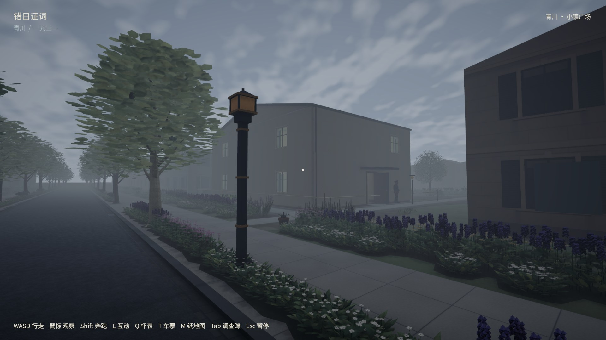
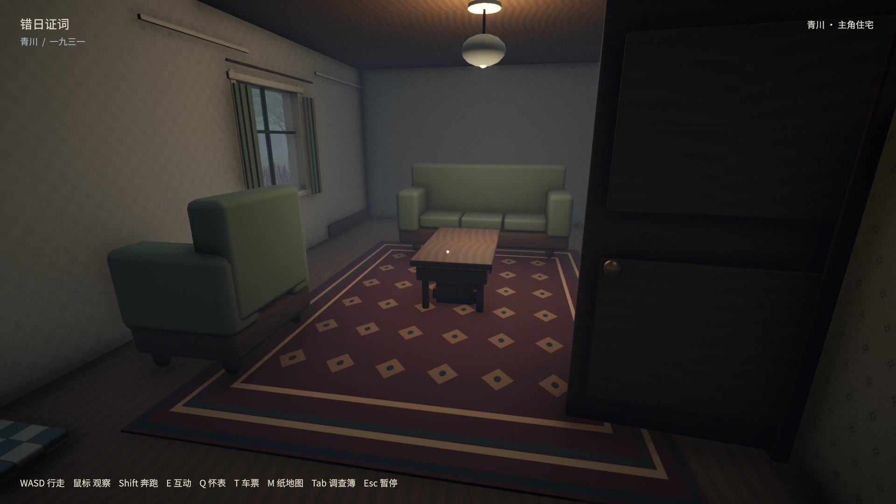
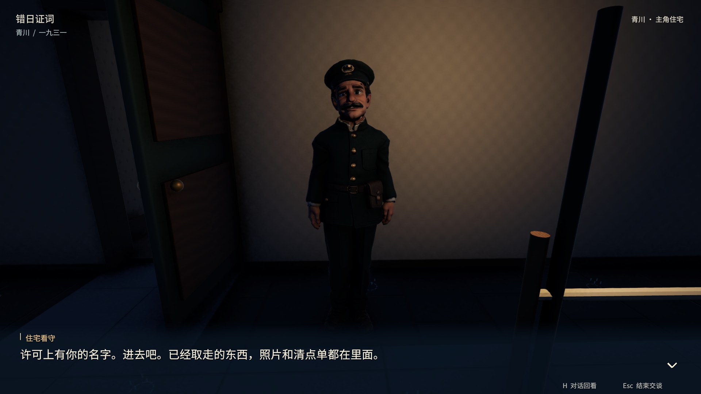

# 住宅初版验收 · HOUSE-01

历史初版记录；后续修正见 [HOUSE-02](../house-corrections/README.md)、[物证检查](../evidence-inspection/README.md)、[逐房摆放](../house-placement/README.md)及[楼梯](../house-stairs/README.md)。不能用初版通行检查证明后续摆放合格。

版本、测试与局限见 acceptance.json。原始截图保留本地 `builds/house-review/push-source-media-20261013/house/`，不随 Git 分发。
