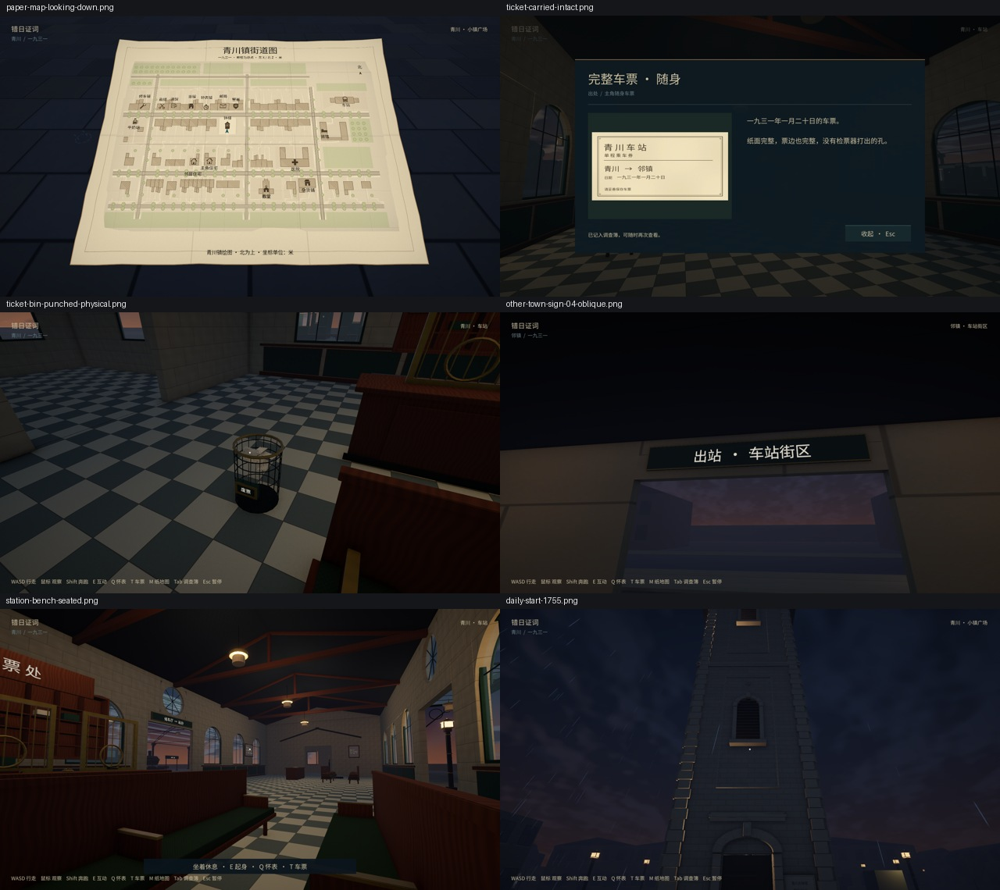

# 最新远端与本地铁路工作合并

2026-10-10：main 从 `ea1f197` 快进至 `7f01ddb`。远端包含手持纸地图、道具音效、每日天气、连续雨声、牛奶店人物/实体门、感光路灯和 6m/s 奔跑、4 倍共享时钟。本地 B 车站、墨绿列车、跨镇往返、真实票孔、59 个休息位、环境物件、车厢灯和 21 块贴面字牌均保留。未提交或推送。

完整本地工作保存在恢复 stash `9a8cfe83c9c716c2df9bd418b772900364d687da`。378 个原文件恢复后无缺失，79 个原始二进制资产字节一致，101 个新资产 GUID 保留；正常存档前后 SHA256 均为 `3a8d86417dc6edf120f20db5529c28d0d31a570335e3e452461714a19e2de265`。

11 个冲突涉及共用脚本、场景/预制件和记录。脚本逐处合并，生成场景由两边合并后的共用生成器重建，并从当前 1202 个碰撞来源重新烘焙导航。纸地图可在青川坐姿使用，发车收起并退出 Alt 编辑；标记跨镇保留，邻镇暂不显示青川路线。阅读物件锁住人物但继续推进新版共享时间，显式暂停和列车转场仍冻结。

Windows / Unity 6000.3.18f1 / URP 17 / D3D11 / RTX 5060 Laptop。最终构建报告 383831201 字节，目录 384026124 字节；程序集 SHA256 为 `5c563c233738f4abdba5d65a382cdc3408752f8f067179219c1704b05bb865aa`。详细版本、逐项日志摘要及完整构建文件哈希见 [acceptance.json](acceptance.json)。

- 12 项原生检查在 `5a9cae4b…` 上通过：720p/1080p 列车往返及各自独立重载；59 座位/8 物件/2 开关及座位重载；纸地图和独立重载；四种取放音效；奔跑/斜向/持图/实体门/钟楼上下阶梯安全；时间与独立重载。
- 后续仅调整 `MilkWindowMotion` 验收机位，使同一实体窗框取样点留在画面内，并补失败诊断。受影响的 8 项环境检查在最终 `5c563c23…` 重跑通过：720p/1080p 天气与独立重载；720p/1080p 昼夜与独立重载；牛奶店门/同屋隔声/雨声/感光灯及独立重载。其余 12 项保留原确切版本，不宣称全部在最终程序集重跑。
- 最终编辑器测试 16/16 通过，覆盖实际车窗/过道/顶面、反例拒绝、真实票孔及安全起身，见 [editmode.xml](editmode.xml)。地图导出 freshness 也通过。

首轮铁路验收残留拍照停表标记，首轮天气的窗框取样点移出视口，失败日志均保留在 `builds/review/latest-merge/`。修正测试时保留实际控制器、实体取样点、原有阈值和断言。测试使用独立 review 存档，原有测试档已备份并恢复；没有使用测试档替换正常进度。

这些是脚本驱动的真实 Unity 渲染、CharacterController、3m E 射线和共用输入处理器检查，不是物理键鼠、陌生玩家盲测或低配 FPS 测量。本轮没有重复完整候选剧情路线计时；原远端校准仍按其原版本记录。部分上游环境结果 JSON 的说明继承 Mac 文案，实际平台以本轮 Windows/D3D11 日志为准。

21 块字牌原生帧接触表：[1](signs-1.jpg)、[2](signs-2.jpg)、[3](signs-3.jpg)、[4](signs-4.jpg)。仅等比缩小/拼接/添加文件名，未调整游戏画面颜色。完整原帧、日志与复验脚本留在忽略的 `builds/review/latest-merge/`；现有 `tools/ReviewRail.ps1 -Signs` 与 `tools/ReviewItems.ps1` 可复验相关流程。
