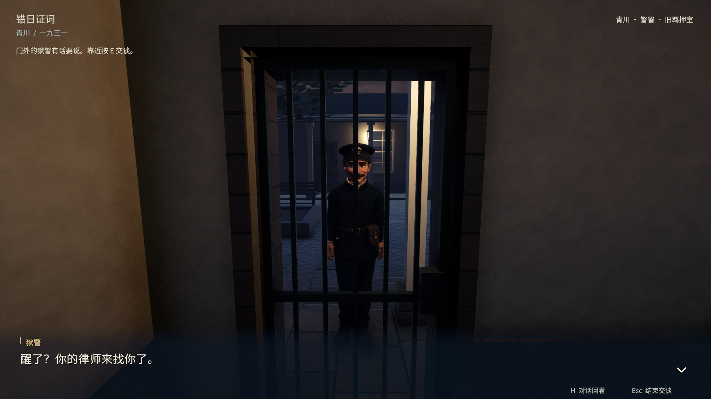
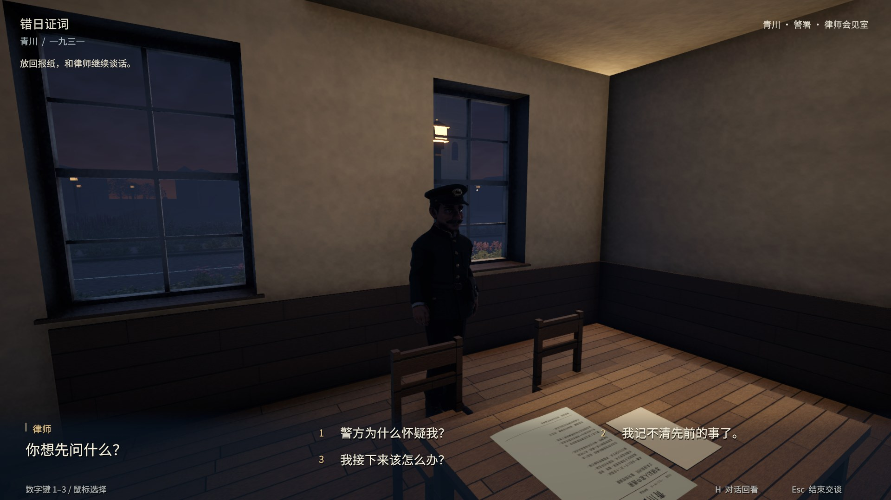
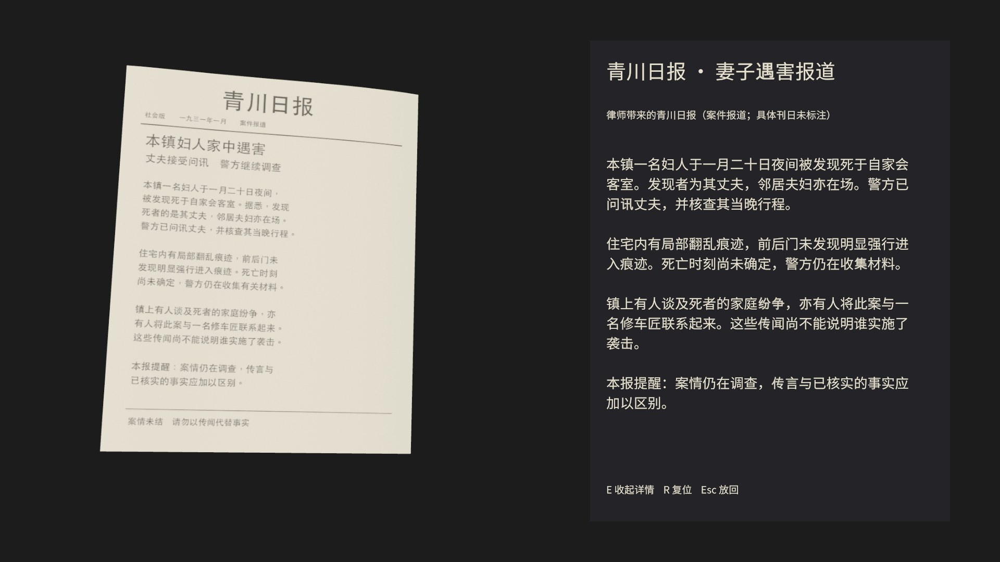
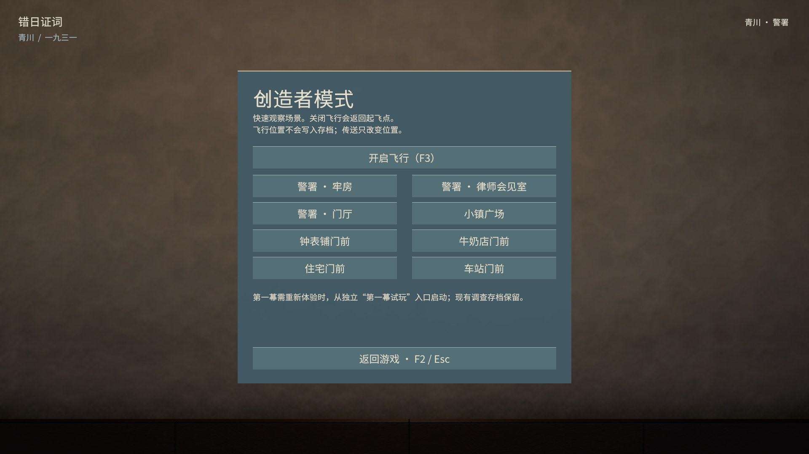
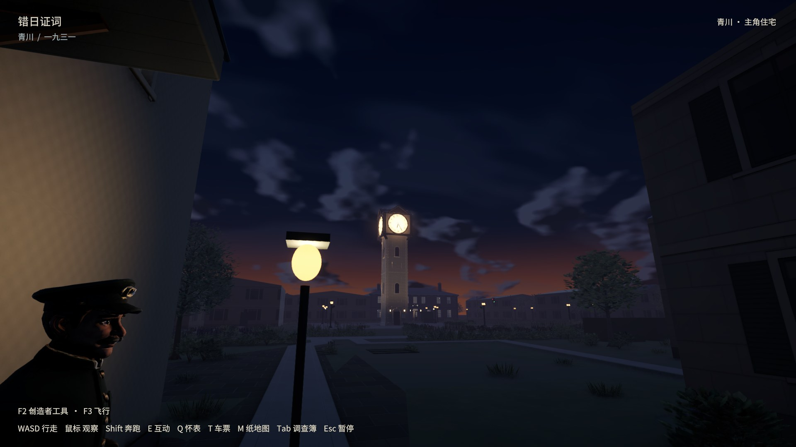

# 第一幕与创造者工具实机记录

第一幕：牢房醒来→狱警通知律师来访并开门→步行穿过内院到会见室→律师介绍案件并带来报纸→三维检查和正文阅读→读后谈话、保释与自由调查。临时角色模型；未新增配音。

最终 Mac 试玩：`builds/opening/final/错日证词-第一幕.app`。独立试玩存档，原调查存档保持。F2八处传送，F3飞行/返回起飞点；空格升、Ctrl降、Shift加速。

最终6项原生验收及24项EditMode通过，具体SHA与范围见acceptance.json。原调查回归保留其独立程序集。六种全图路线走通，但旧住宅看钟代理点最后被当前打开的门扇挡住；修正测试站位后只复验实际门前眼高视线与独立室内存档，未重跑全部长流程。

程序驱动真实控制器/普通交互射线和共用界面处理，并目视720/1080中文；不是物理输入或盲测，也不是Intel/低配实测。

