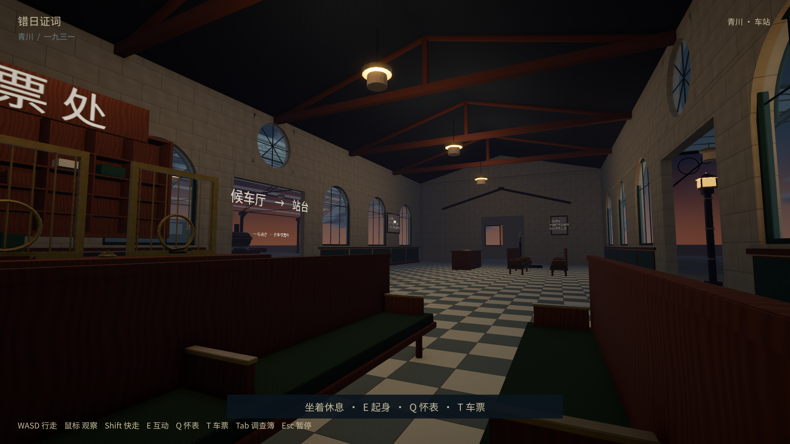
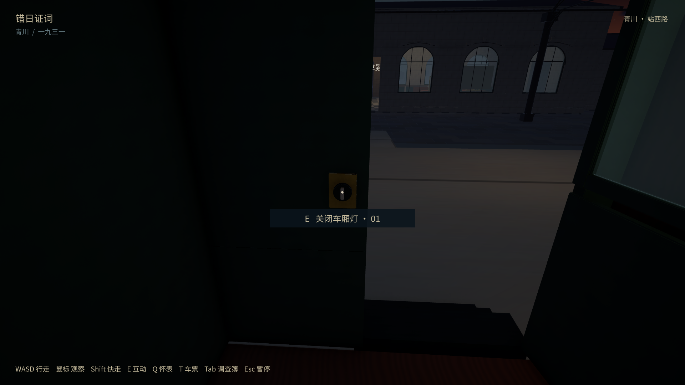

# 可交互椅子、车厢灯与环境物件（2026-10-10）

新增59处休息位：8张街边长椅、候车厅4张长椅上的8处座位、两节客车43处普通座位。对准椅子按 **E** 坐下，再按E起身；坐着可以转头、Q看怀表、T查看完整原票、Tab打开调查簿。世界时间继续，阅读／暂停按原规则冻结，关闭界面仍坐在原座位。原来的指定发车座位保持“坐下并出发”。

车厢门厅南侧的旋钮开关实际控制该节四盏既有吊灯；旋钮可转动，手动关闭状态在重启与跨镇后保留。共8处新环境查看：三种告示、行李秤、站台推车旅行箱、车厢行李架的卷包和两只小箱。环境阅读不增加证物或案件结论，E02无孔／E03有孔继续保持。

Windows播放器在`builds/windows/TownDemo.exe`，所有数据文件须留在同目录。实现／编辑源见 [说明](../../../docs/rail-implementation.md)。检查入口为`tools/ReviewItems.ps1`及既有`ReviewRail.ps1`。结果、具体版本、哈希和限制见 [acceptance.json](acceptance.json)。

| 检查 | 范围 |
| --- | --- |
| [720p物件／座位](720/items-results.json) | 普通E射线逐个验证59座位，起身可走；实际控制器走动完成8种环境查看、2种灯开关；休息计时、怀表／原票、阅读暂停、堵住出口后禁止起身 |
| [1080p物件／座位](1080/items-results.json) | 同上；保存真实长椅与车厢坐姿检查点 |
| [最终1080p提示／画面](final-1080/items-results.json) | 提示明确“坐下休息”“开／关车厢灯”，全部新互动再次通过 |
| [车厅读档→跨镇](reload-travel/items-save-results.json) | 独立进程恢复普通坐姿与关灯，起身并通过原E发车到邻镇；普通座位状态清除、灯关保持，再坐普通座位并保存 |
| [邻镇普通座位重载](reload-next-town/items-save-results.json) | 新进程恢复OtherTown普通坐姿与灯关，查看原票、起身与移动 |
| [候车长椅重载](reload-bench/items-save-results.json) | 将真实bench-checkpoint原样复制到隔离档；新进程恢复同一长椅、查看原票、起身与移动 |
| [原列车往返](rail-regression/rail-results.json)／[重载](rail-reload/rail-save-results.json) | 原发车座位、两节客车、两次跨镇、E02／E03／E08、原票无孔、废票真孔与安全发车检查点继续通过 |
| [EditMode16/16](edit-tests-final.xml) | 既有12项加4项真实站立空间测试：有地面／无地面、物件堵住出口拒绝、交互触发体不堵物理空间 |

最后只修改互动提示文字，未改变座位、灯、存档、碰撞或发车逻辑；最终1080实机和16项测试复验，其他通过项保留各自确切构建。首次验证路径直穿行李秤立柱而失败，已改为绕托盘靠近，未取消实体碰撞；失败原始资料留在本机attempt-01，不作为通过证据。

所有检查均使用隔离review存档。旧正常播放器先正常退出并保存最新进度，作为本轮正常档基线（451B35112DBFCF8C95CBAE42E7719FFB481A2643197C429FE51E826B1C1B5D3F），测试期间不改该文件。脚本逐座位阶段在安全过道放置玩家，然后走普通3m E射线；物件路段使用真实控制器，起身与界面用同一处理函数。不是物理键鼠、陌生玩家盲测、完整59座位步行路线或低配FPS测试。没有提交／推送。

检查结束后从原入口启动正常新版，1600×900窗口、进程正常响应，日志确认正常存档路径且没有异常；启动前后正常档仍同哈希，见 [normal-launch.json](normal-launch.json)。点击“开始漫步”恢复已有候车厅进度。
