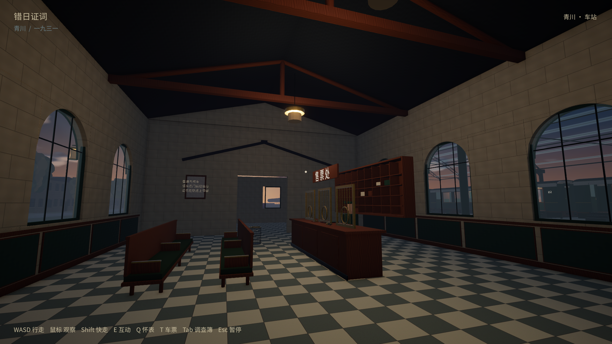
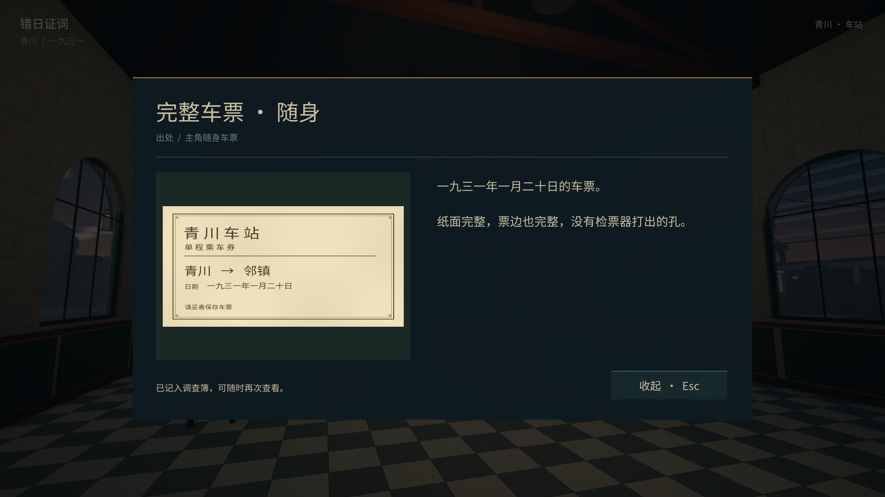
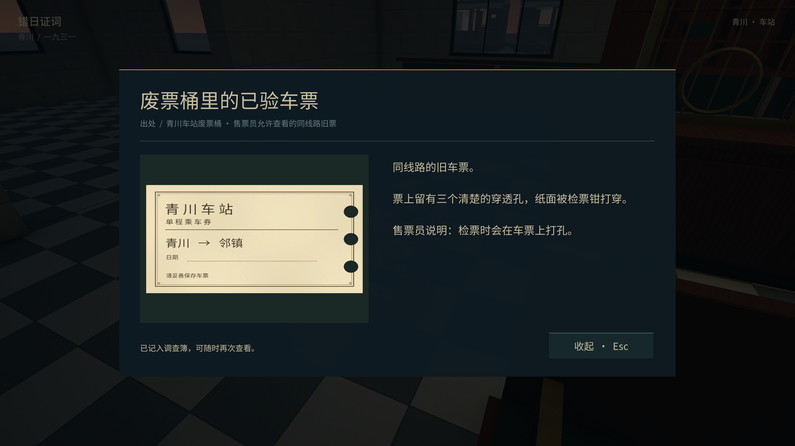
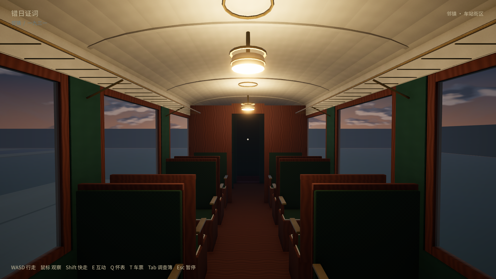

# 铁路细化与已验／未验车票（2026-10-10）

依据用户选定的B铁玻璃车站、墨绿黄铜列车增加模型细部、表面质感与纸票差异。Windows播放器在 `builds/windows/TownDemo.exe`，需要同目录数据文件；可编辑源为 `StationB.blend`、`TrainSet.blend`、`TicketProps.blend`，生成器与重建步骤见 [实现说明](../../../docs/rail-implementation.md)。

- 车站：圆拱实际开口、石材分缝与墙脚／檐口、铁玻璃入口雨棚、灯具与铁架连接、柜台开放票格、护墙、长椅、告示、检票钳、废票桶与行李推车。
- 列车：木框扶手、织物压边、黄铜灯与顶棚肋条、窗锁、开放行李架／行李，机车管线、锅炉箍、铆钉、板簧与制动件。原窗、门和过道保持通透可走。
- 九套原创可平铺基础色／法线／金属光滑度表面；共享中文字体补字并核对旧字形保留。
- **T** 打开主角随身E02完整票，全部纸面完整、无孔。废票桶中八张E03票全部有三个真实穿透孔；放大与调查簿使用同坐标透明孔，仍可看见衬底。乘车和存档重载不对原票打孔。E02/E03稳定ID保留，没有自动推理结论；未确认的废票历史日期留空。

Antigravity只在隔离scratch起草细节套件；本地复核修正拱窗、被挡票格、占窗行李架、告示朝向与废票桶位置，并负责票面、真实孔洞、Unity交互和验收。

全部检查的版本、哈希与结果见 [acceptance.json](acceptance.json)。最后一次资产修正只把废票桶从长椅末端向左移0.7m，避免遮挡；本轮记录每组检查的具体构建，不把之前候选构建伪称为最终资产。原生脚本使用真实CharacterController、普通3m E射线、同一UI处理函数与实际场景加载；不是物理键鼠、盲测、强杀进程或帧率基准。

| 检查 | 证据 |
| --- | --- |
| 1080p完整往返 | [1080/rail-results.json](1080/rail-results.json)：两节客车实走、废票桶E射线、随身原票、跨镇保留E02/E03/E08、返回Town、2次乘车 |
| 720p完整往返 | [720/rail-results.json](720/rail-results.json)：同一路线与票孔／完整票检查、2次乘车 |
| 本镇两档独立重载 | [1080-reload](1080-reload/rail-save-results.json)、[720-reload](720-reload/rail-save-results.json)：时间／证物／座位保留，原票无孔，可起身下车 |
| 邻镇独立重载 | [next-town-reload](next-town-reload/rail-save-results.json)：实际邻镇检查点、新进程恢复、查看完整原票、下车 |
| 发车安全检查点 | [departure-reload](departure-reload/rail-save-results.json)：实际发车检查点原样复制到隔离save后新进程恢复出发站；没有强杀测试 |
| [EditMode12/12](edit-tests-final.xml) | 真实窗／拱窗、顶面、过道及错误几何拒绝；新增4项真实票孔／完整票互换拒绝测试 |
| Blender票源 | [ticket-source-checks](../../../assets/source/rail/ticket-source-checks.json)：源保存重开，三个孔的射线穿透与完整纸面射线成立 |
| 时间／奶屋回归及独立重载 | [时间](regression-time/time-results.json)、[时间重载](regression-time-reload/time-save-relaunch.json)、[奶屋](regression-milk/milk-a-results.json)、[奶屋重载](regression-milk-reload/milk-a-save-relaunch.txt) |
| 数据检查 | 10证物／D02、D03／6种设计访问顺序，地图70宅地／20角色／17路线 freshness通过；本轮没有重复历史六种全镇室外路线 |

正常存档的本轮基线及验证后SHA256均为 `E1B5BC65F2C5779B98F9F65B1570B999D83E8F9251CFC50C431C1A428350ECC4`，所有测试使用独立review档。前一轮基线与这次不同，因为用户在两轮之间手动试玩；没有回滚其进度。没有提交／推送。完整邻镇案件、陌生玩家盲测和低配性能仍未验收。
