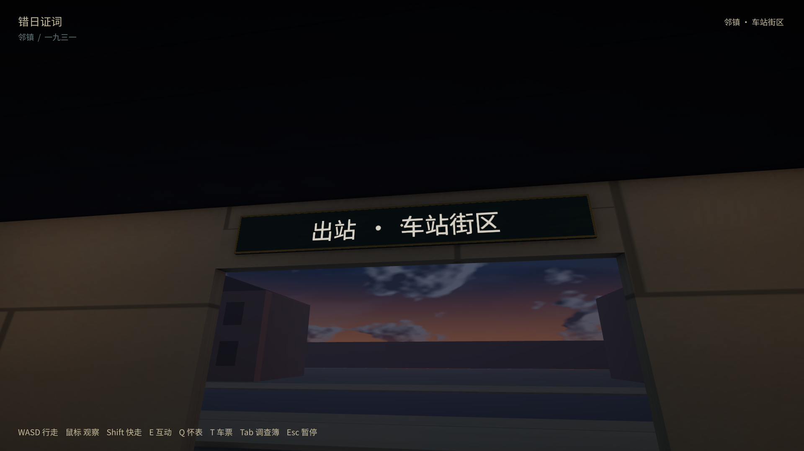

# 车站与列车文字贴合修复（2026-10-10）

修正本镇14处、邻镇7处世界文字：站名、英文站名、售票处、站台、候车厅方向、三张告示、废票桶标签、两节车厢编号／线路及邻镇出站牌。文字按实际可见牌面留边、缩放、居中，距实体表面2mm。既有牌面从导入网格的连通共面三角形取尺寸及法向，并抵消FBX父级的100倍单位缩放；字体图集重建后重新排版。背面剔除，避免从牌背看到反字。

补全入口雨棚上的站名牌、候车厅后门门楣上的方向牌、废票桶小标签和站台立柱牌。邻镇“出站 · 车站街区”放在厅内朝南出口的门楣，外侧站名仍贴在同一实体门楣。告示与车厢标识贴合现有纸面／车漆，不重建门窗或道路。所有修改来自共用Unity生成源，不分别移动场景副本。

| 已通过检查 | 实际范围 |
| --- | --- |
| [1080p](1080/sign-results.json)／[720p](720/sign-results.json) | 各21处字面几何边界、四角与实体牌面的射线距离；字号64→80→64后再次检查。原生渲染逐牌画面，并完成两次跨镇的完整原列车路线 |
| [家具与物件](items/items-results.json) | 59普通座位、8环境查看、2车厢灯、休息／起身／阅读／出口阻挡等原交互继续通过 |
| [独立进程列车重载](rail-reload/rail-save-results.json) | 实际返程检查点恢复、原票／进度保留、起身并下车 |
| [EditMode16/16](edit-tests.xml) | 原共享窗洞／过道／雨顶、真实票孔与家具安全站立空间检查 |

上述5项使用同一最终Windows二进制，具体构建、日志哈希及正常档隔离见 [acceptance.json](acceptance.json)。查看21处的原生截图缩小接触表：[1](sign-gallery-01.jpg)、[2](sign-gallery-02.jpg)、[3](sign-gallery-03.jpg)、[4](sign-gallery-04.jpg)；接触表只拼接、缩小和加标题，未修改游戏画面的颜色。原始截图在本机保留，Git只留关键画面。

复现：`tools/BuildDemo.ps1`，随后`tools/ReviewRail.ps1 -Mode round-trip -Signs -Width 1920 -Height 1080 -Output output/demo/rail-signs/1080`，另跑1280×720；交互入口为既有`ReviewItems.ps1`。牌面视点由脚本在玩家高度布置，字体变化也由脚本驱动；原往返使用真实CharacterController、普通3m E射线和共享处理函数。不是物理键鼠、陌生玩家盲测、全镇所有招牌审计或低配FPS测试。

本轮没有新增剧情事实、班次或证物。正常游戏先正常退出并保存最新进度，基线与测试后SHA256均为3A8D86417DC6EDF120F20DB5529C28D0D31A570335E3E452461714A19E2DE265，所有测试使用隔离review档；没有提交／推送。

结束后已重新打开正常新版，窗口响应正常、启动日志无异常，存档哈希保持，见 [normal-launch.json](normal-launch.json)。点击“开始漫步”恢复候车厅现有位置。
