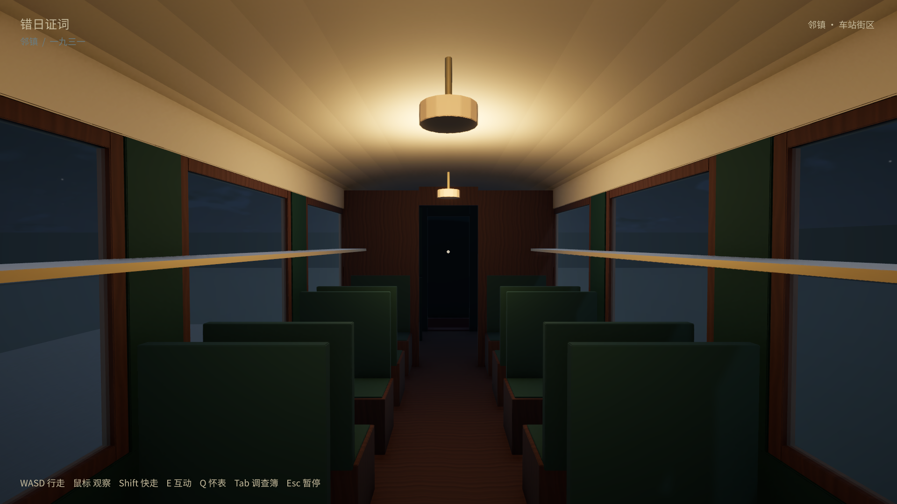
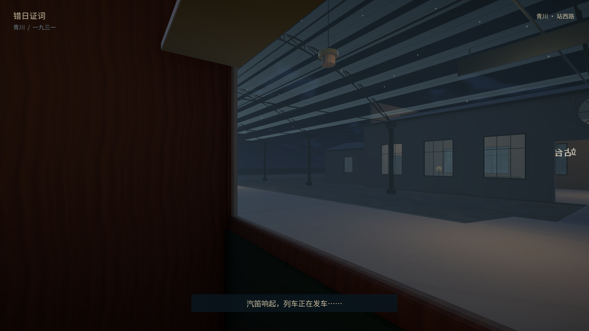
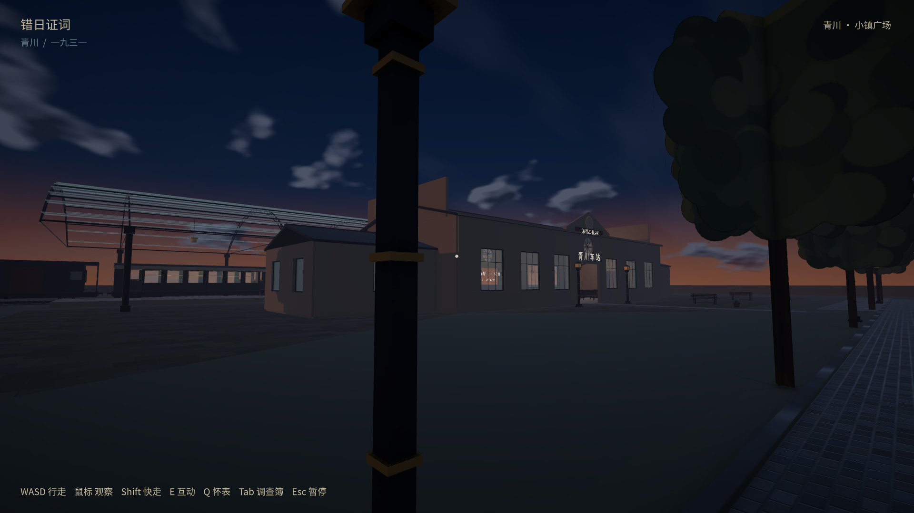

# B 车站与列车：2026-10-10 验收

本页记录首次实现的历史构建。用户随后要求增加细节、材质和两类车票；当前结果见 [铁路细化验收](../rail-polish/README.md)。以下初版哈希、8项测试和截图保留为历史记录。

已实现 B17 铁玻璃车站、墨绿黄铜蒸汽列车、两节可步行客车，以及「登车 → E落座 → 关门鸣笛、蒸汽与轮组启动 → 短距离移动 → 渐黑 → 邻镇同座位渐显 → E起身下车 → 再次登车返回」。Windows播放器在 `builds/windows/TownDemo.exe`，需要保留同目录的数据文件。

以下最终检查均使用同一最终Windows程序集，哈希、证据和范围记录于 [acceptance.json](acceptance.json)。原生检查通过脚本驱动真实CharacterController、普通3m交互射线与实际场景加载；不是物理键鼠操作、陌生玩家盲测或低配FPS测试。

| 检查 | 最终结果与证据 |
| --- | --- |
| 1920×1080 完整往返 | [1080/rail-results.json](1080/rail-results.json)：两节客车、踏步/连接过道实走、E03/E08射线、雨中车窗、实际位移、跨镇及返回，2次乘车 |
| 1280×720 到邻镇 | 本机 `720/player.log` 的 `RAIL_NEXT_TOWN_CHECKPOINT_PASS`；与1080使用同一最终版本，1次乘车；不是720完整往返 |
| 本镇到站座位重载 | [reload-town/rail-save-results.json](reload-town/rail-save-results.json)：独立进程恢复Town、2次乘车、时间/证物、E起身与下车 |
| 邻镇到站座位重载 | [reload-next-town/rail-save-results.json](reload-next-town/rail-save-results.json)：独立进程恢复OtherTown、1次乘车、时间/证物、E起身与下车 |
| 发车安全检查点重载 | [reload-departure/rail-save-results.json](reload-departure/rail-save-results.json)：将720实际发车时保存的 `departure-checkpoint.json` 原样复制到隔离存档，独立进程恢复出发站Town、0次乘车、证物与时钟；运行时另断言移动期间Save不覆盖停靠检查点。本次没有执行强制杀进程测试 |
| EditMode | [edit-tests-final.xml](edit-tests-final.xml)：8/8，真实网格开口/过道/顶面、错位与窗背板拒绝、屋顶剖面 |
| 原有时间系统及重载 | [regression-time/time-results.json](regression-time/time-results.json)、[regression-time-reload/time-save-relaunch.json](regression-time-reload/time-save-relaunch.json)：7秒/10分钟、阅读暂停、Q继续、跨小时/午夜、塔钟+30、旧档字段与独立进程恢复 |
| 原有奶屋及重载 | [regression-milk/milk-a-results.json](regression-milk/milk-a-results.json)、[regression-milk-reload/milk-a-save-relaunch.txt](regression-milk-reload/milk-a-save-relaunch.txt)：真实进出、两侧窗、订单/数量、普通交互、灯与重载 |
| 全镇作者数据与地图网页 | 70宅地/4成品/11道路，地图导出及浏览器 `MAP_UI_PASS`；20角色、17路线。本轮未重复之前的六种完整室外顺序 |

源文件为 `assets/source/rail/StationB.blend`、`TrainSet.blend`，最终生成器在 `tools/rail/`。Antigravity在隔离scratch提供建模初稿；最终开窗、车门/轮组枢轴、屋顶、碰撞、Unity实现与验收由主代理复核修正。Blender预览只用于源资产检查，下列截图均来自最终原生游戏。

测试只使用独立review存档，正常 `slice-save.json` SHA256前后均为 `FDE6BCE28F10294A989DC5052A88111F08855E624BC756BEFD3A1BB326B58839`。没有提交或推送。

邻镇目前只实现可步行的车站街区和返回列车，背景店屋为外景占位。未加入完整第二镇、历史班次/车程、问路证人或案件闭环；E03/E08遵守原证物合同，不自动推出杀人结论。重建和复验入口见 [实现说明](../../../docs/rail-implementation.md)。早期修复前检查在本机保留，不作为最终结果。
