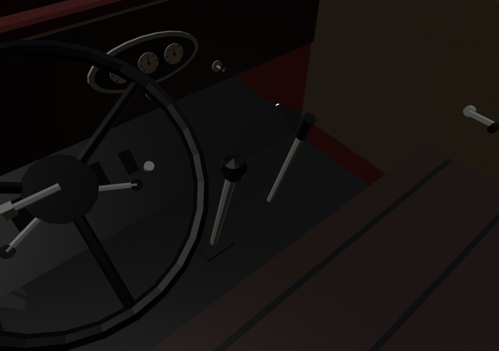
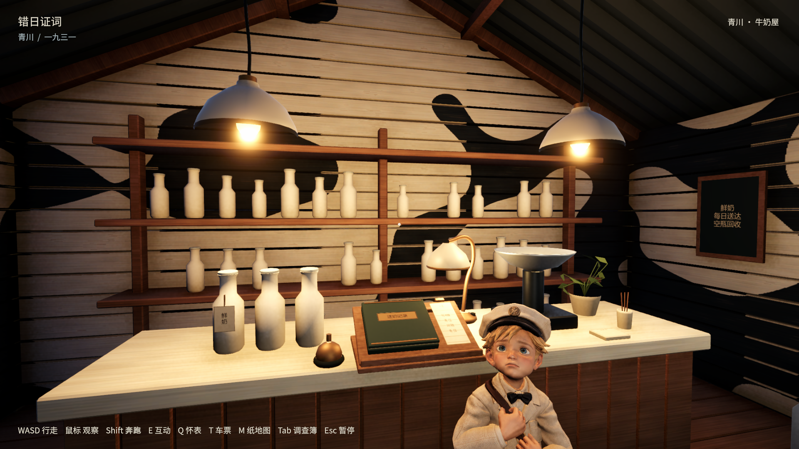
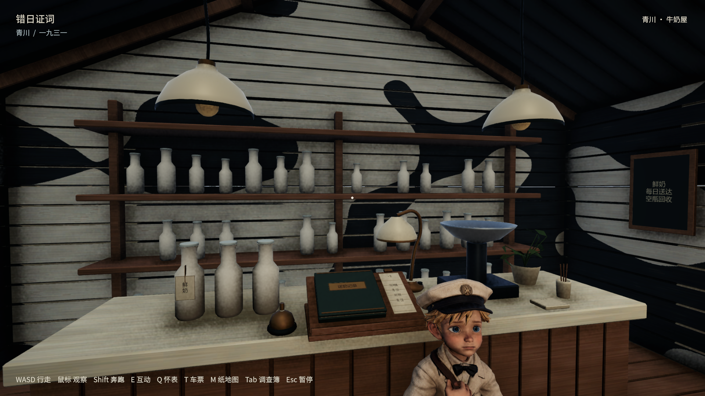
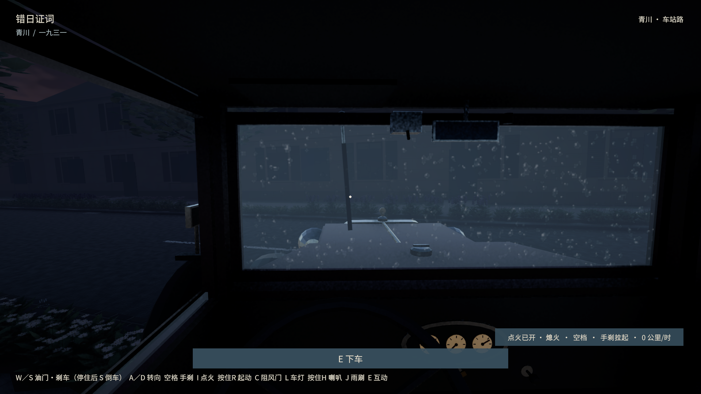

# 汽车手刹与牛奶店昼夜检查修复

2026-10-12，main/origin/main仍为7618050；保留上一轮街道改动，未提交或推送。桌面「错日证词-新版」已更新。

## 原因与改动

- **瞄准偏差**：`PlayerMotor.Aim`从旋转前的眼睛位置求方向，再把身体设成世界水平朝向；有前后偏移的眼睛随转头移动，车身倾斜也被错误抹掉（本车合同眼位前后偏移为0，倾斜仍会影响瞄准）。现以身体枢轴和座椅局部坐标求朝向，并在转头后重新求俯仰。三个带眼位偏移的场景在旧代码中偏差约5.12°、2.77°、16.86°，新代码均低于0.05°。普通鼠标仍走既有局部转头路径。
- **倒挡遮挡手刹**：正确瞄准后，发现倒挡＋手刹完全拉起时，变速杆确实遮住手刹目标。手刹整套向车内右侧移14cm（x=.12→.26），同步修改生成源、Blender/FBX、枢轴和目标；未移大碰撞盒或扩大交互距离。对96个源对象比对，只有Handbrake与Pivot_Handbrake变化；布局只有对应part/control变化。15组档位×手刹位置检查从14/15变为15/15。
- **再上车测试**：车身倾斜时，座垫中心可能在中柱后。车外脚本改瞄准同一座位目标内露出的前部，保留首命中普通3m E射线；不移动中柱/座位或扩目标。
- **牛奶店旧路线**：昼夜脚本仍前往少年移到柜台前之前的站位。改走真实顾客过道：灯在x=.90侧、账本在x=-.85侧，沿z=-1.10横向绕行，并从过道进入两侧窗口。保留碰撞、人物位置、普通E射线、原照明与全部断言。

## 最终验证

Unity6000.3.18f1、macOS/Apple M5 Pro/Metal；汽车和街道使用最终build03；昼夜四项使用build02，其生产代码/模型与03相同，仅缺少随后修正的汽车测试座位瞄准点。74项EditMode通过，其中包含3个瞄准回归、15个档位/手刹组合与原汽车/铁路检查。

| 实机项目 | 720p | 1080p |
| --- | --- | --- |
| 完整汽车：33个交互点、起动/换挡/制动/倒车、撞墙退离、手刹、地图、车灯、门窗雨声、发动机罩/行李箱、手摇、翻车扶正 | PASS | PASS |
| 汽车独立进程读档并重新起动开走 | PASS | PASS |
| 完整昼夜：日出/日落/午夜、自动灯/发光、手动关灯、阅读计时、暂停、牛奶店两侧窗真实移动、钟表铺 | PASS | PASS |
| 昼夜独立进程读档：准确时钟、室内位置、手动关灯与账本日期 | PASS | PASS |
| 上轮街道路口/信号灯/路缘回归 | — | PASS |

详细结果、时长与资源散列见[acceptance.json](acceptance.json)。原始日志、初轮失败与旧包保留在忽略的`builds/review-fixes/`。`aim-before.xml`和`brake-before.xml`是特意在修复前保存的失败证据，最终结果为`editmode-final.xml`。

这是程序驱动的真实Unity实机检查，不是物理键鼠或陌生玩家盲测；未构建Windows。正常存档前后散列相同，先前的汽车/昼夜review检查点已恢复。应用严格签名验证通过；旧zip未更新。

## 画面

以下为Blender布局核对，非游戏截图：

以下为最终Unity实机：

