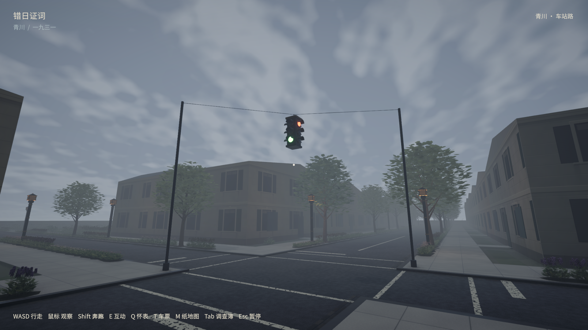
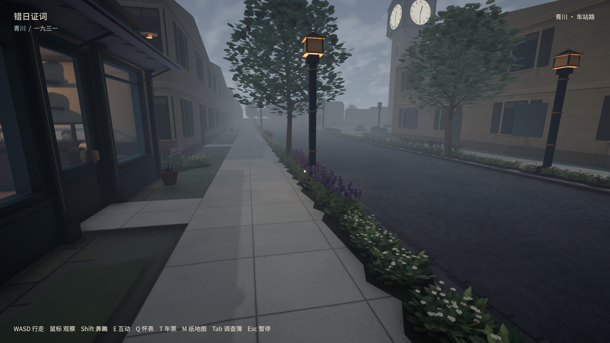
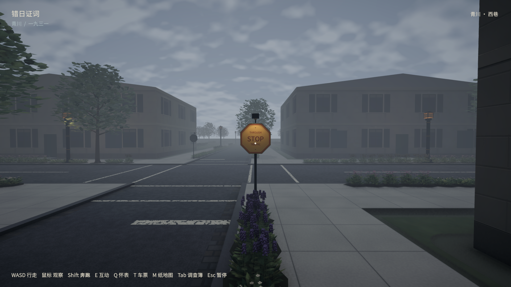
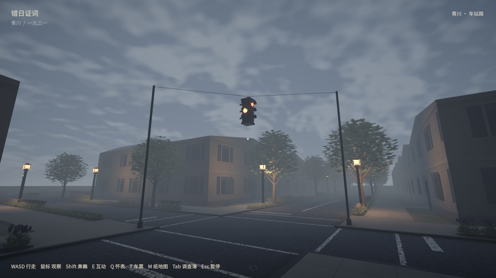
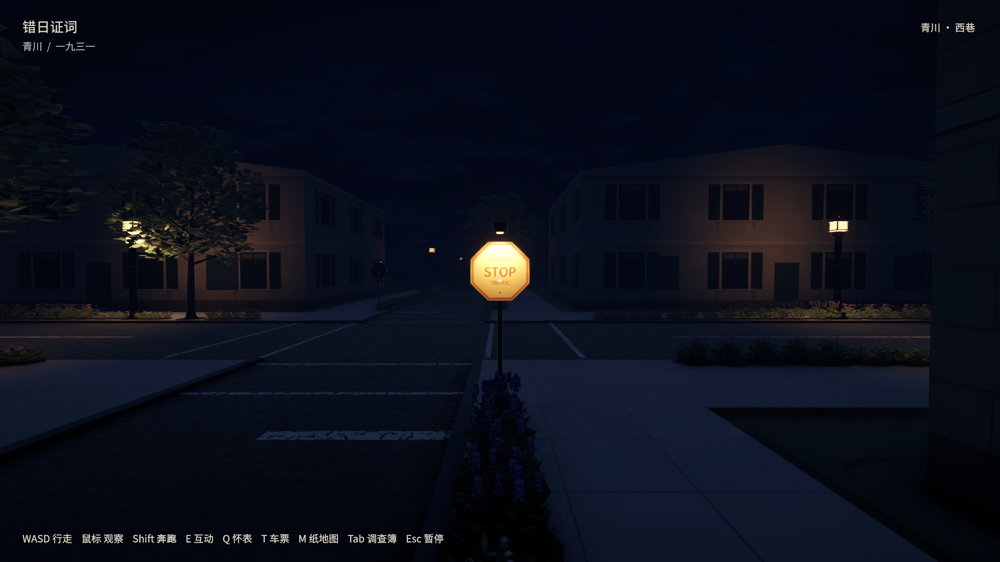

# 1930年代美国街道 · Mac实机

后续：本文记录的两项旧回归失败已在[手刹与昼夜修复](../review-fixes/README.md)中解决并重跑通过；以下保留街道版原始验收记录。

制作日期：2026-10-12。开工CLI fetch/pull：`main=origin/main=7618050`，没有新提交。没有commit或push。

## 已实现

- 原创2K旧沥青与分格混凝土；石路缘立面、石砌排水边沟和108组铁箅子。
- 16块黄底红字八角 `THROUGH / STOP / TRAFFIC`，带牌背夹件、铆钉和夜间小罩灯；三处主街路口双白线横道及少量白色停止/中心线。
- 车站路×中街一组悬吊四面三色灯，约4.46m路面净空。随共享保存时钟推导相位，显式暂停冻结；无额外信号点光、车流AI或罚则。牌灯借用已有12盏附近灯池。
- 原街道编译器使用无约束三角剖分并丢弃跨边界三角形，导致大块人行道露出底层。改为约束剖分、逐块面积检查和Unity向上绕序检查；填回人行道9994.003㎡、路缘168.840㎡、院落1633.481㎡，原有道路面未删除。
- 原平面图和证据合同字节相同；道路中心/宽度、建筑、树木与植物/土面位置相同。GreeneryPlan仅同步源文件换行散列。详见`source-preservation.json`。

## 考据

[调查与原始出处](../../../docs/research/us-streets-1930.md)。1930城市手册的黄底红字与1927公路系统黄底黑字有别；本轮选城市方案。美国Yield首设1950，故不放现代让行牌。横道选边界双线，不默认今天的斑马线；不采用现代双黄线或倒三角地面标记。字形及具体设施造型是原创近似，不宣称复制某市某厂家。

## 实际验证

Unity6000.3.18f1、macOS/Metal，原生播放器。`street-results-720.json`与`street-results-1080.json`记录专用街道检查：所有道路净人行道胶囊扫查、真实控制器穿越路口与路缘、三色灯互斥相位、实际灯片发光、同一时钟推进与显式暂停。机位与天气由脚本设定，不是物理键鼠或玩家盲测。

构建04已通过全镇11种道路断面、六种住宅/车站/钟表铺**室外访问顺序**和独立进程室内存档重开；不是六次完整剧情盲测。最终构建05仅增加街道检查的夜间切换机位等待和路牌灯断言，生产代码/资源相同；720p/1080p街道检查已在05重跑。每项检查的程序集和最终结果见`acceptance.json`。

两项既有通用回归未通过，并在改动前备份播放器上复现：汽车撞墙倒车后的手刹交互射线命中车身；昼夜检查在牛奶店旧灯具接近点被现有柜台侧人物/布局挡住。未以关闭碰撞、改人物站位或放宽断言来通过。这两套完整检查及其存档后续不能计为PASS；详见`car-regression-result.json`、`baseline-car-result.json`、`day-night-regression-result.json`。街道专用检查中的实际光源、红绿灯相位、雨/夜画面与暂停仍通过。

最终构建05的完整奔跑检查与独立读档均通过：真实控制器往返、地图最短导航、归一化斜向移动、持图奔跑、关闭/开启店门、101点钟楼上下楼梯。当前候选剧情路线上去程335.63m／56.21现实秒，返程298.82m／49.86秒；12倍时间下约17:46:15到站、17:58:15返家（含测试短停10现实秒），原17:40／17:55剧情窗口仍**不满足**。路线可走不证明历史人物走过它；未改剧情、倍率或速度。结果见`sprint-results.json`。

正常存档前后SHA256一致；本轮用独立review存档。新版Mac应用严格签名检查通过；没有重新构建Windows包。

[路口行走实录](街道路口实机行走.mp4)为原速6.38秒Unity画面与游戏AudioListener声音，128张原始画面按墙钟时间戳合成；未加速、未配旁白。原始帧与完整日志留在忽略的`builds/street-1930/`。

## 入口与复建

桌面「错日证词-新版」经原链接指向本仓库`builds/macos-current/错日证词-新版.app`。签名、程序集与正常存档校验见`build-provenance.json`和最终验收。构建包与原始视频帧不入Git。

纹理/设施来源：`tools/build_period_streets.py`、`StreetSurfaces.Period.cs`。地面来源：`tools/build_full_town.py`，需要Shapely≥2.1；运行生成器后用共享`BuildSlice.BuildFreshMac`构建。若地图源真的改变，还要重编完整地图与绿化，不能仅修改散列来绕过匹配。
