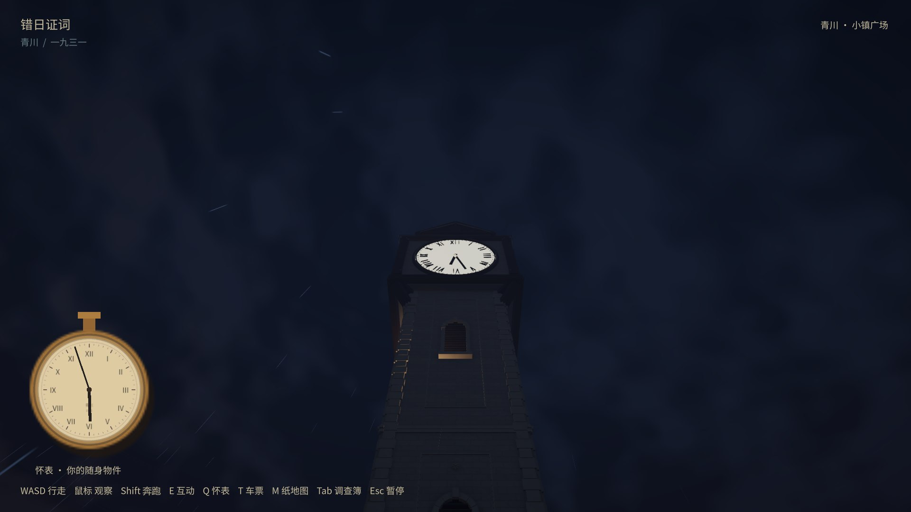
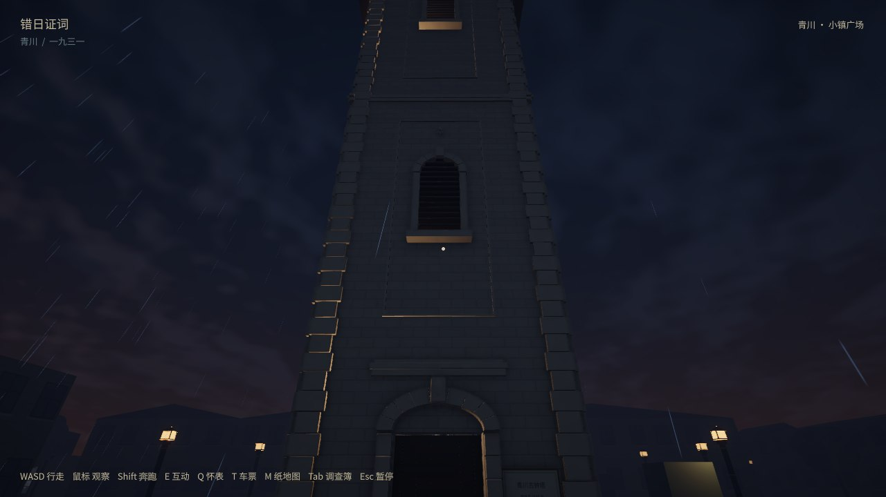
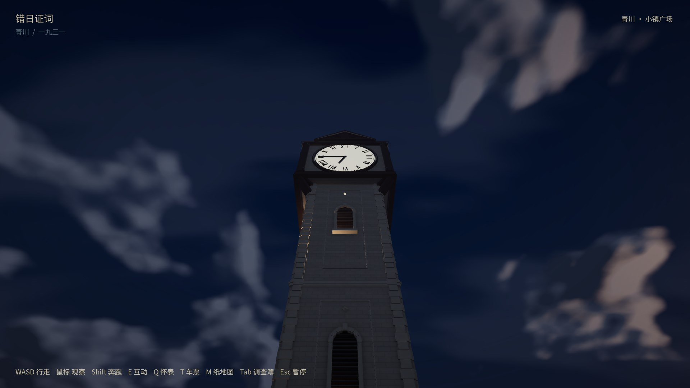

# 完整一天改为现实两小时（2026-10-10）

用户最新要求完整24小时昼夜为现实2小时，取代此前4倍／6小时校准。当前共享GameClock为12倍：现实1秒=游戏12秒，现实50秒=游戏10分钟，完整一天7200现实秒。怀表、塔钟、昼夜、天气继续读取同一累计游戏分钟；5游戏分钟天气渐变为25现实秒。人物行走2.5m/s、Shift跑6m/s；开局17:55、塔钟默认快30游戏分钟、阅读不停表和显式暂停规则保持原值。已有存档不重算、不清零、不补离线时间。

AGENTS.md、MVP、证据开发合同、地图说明与两个项目技能均已同步，托管安装技能也已更新。CLI fetch后main/origin/main同7f01ddb，没有新增提交；之前的本地铁路工作及恢复stash保留，未提交／推送。

## 实际验证

Unity6000.3.18f1／Windows／D3D11／RTX5060Laptop。新程序集SHA256：`3122f247a339761aa5a6087cc2b1073ed00dc64051f0866682af6b995c7342f1`，构建报告383833109字节，完整目录384028032字节。下列11项均为同一新程序集，原生日志无运行异常；编译和地图freshness也通过。

| 检查 | 分辨率 | 实际通过标记 | 结果 |
| --- | --- | --- | --- |
| time | 1920×1080 | TIME_REVIEW_PASS | 通过 |
| time-reload | 1920×1080 | TIME_SAVE_RELAUNCH_PASS | 通过 |
| sprint | 1920×1080 | SPRINT_REVIEW_PASS | 通过 |
| sprint-reload | 1920×1080 | SPRINT_SAVE_PASS | 通过 |
| weather-1080 | 1920×1080 | WEATHER_REVIEW_PASS | 通过 |
| weather-720 | 1280×720 | WEATHER_REVIEW_PASS | 通过 |
| weather-reload | 1920×1080 | WEATHER_SAVE_RELAUNCH_PASS | 通过 |
| day-night-1080 | 1920×1080 | DAY_NIGHT_REVIEW_PASS | 通过 |
| day-night-720 | 1280×720 | DAY_NIGHT_REVIEW_PASS | 通过 |
| day-night-reload | 1920×1080 | DAY_NIGHT_SAVE_RELAUNCH_PASS | 通过 |
| legacy-rate-reload | 1920×1080 | TIME_SAVE_RELAUNCH_PASS | 通过 |

时间实录7.001113现实秒推进1.400223游戏分钟；检查连续表针、塔钟共用时间、跨小时／午夜／多日、旧缺失字段、阅读与显式暂停、正常15秒活跃时间自动保存及独立进程读档。完整一天是原生验收内调用GameClock推进7200秒输入，验证精确增加1440游戏分钟及暂停不推进；没有宣称连续运行两小时的稳定性测试。

两种分辨率分别执行真实昼夜边界、天空／灯光／云雨连续变化、室内外灯控、阅读不停表与显式暂停，并独立进程检查天气／光照和手动关灯恢复。奔跑检查重新走通候选往返、两方向地图近路、直行／斜行、持图、实体门碰撞、101点钟楼上下楼及独立读档。

额外运行保留的4倍旧播放器（程序集`5c563c233738f4abdba5d65a382cdc3408752f8f067179219c1704b05bb865aa`）实际生成旧倍率检查存档，随后由新12倍播放器载入。旧保存累计1.147246857733游戏分钟在新进程原值恢复，不乘3、不补离线时间，并保留证物／对白。此旧版生成检查单独列出，不混入上表11项新版本通过。

天气读档的初始外围脚本误期待WEATHER_SAVE_PASS，原生播放器实际退出0并打印WEATHER_SAVE_RELAUNCH_PASS。已按未改动的原生日志纠正汇总标记，保留原始错误汇总；没有重用已消耗的读档检查点，也没有修改运行断言。

## 剧情窗口实测

以下是程序驱动真实控制器并录屏的当前Windows测量，停止点仍是住宅／车站室外门前，不含车站室内；住宅室内未完成。停10现实秒是假设测试停留，不是新历史事实。

| 候选路线 | 实际行走距离 | 现实耗时 | 怀表耗时 |
| --- | --- | --- | --- |
| 公共道路去程 | 337.36m | 57.527秒 | 11.509分钟 |
| 后巷返程 | 301.15m | 50.202秒 | 10.043分钟 |

17:35出发约17:46:31到站，停10现实秒后约17:58:36返家。原17:40到站／17:55返家的两个剧情时间窗口均未满足，`storyWindowFeasible=false`；引擎／计时检查通过不能冒充剧情可行性通过。保留原证言、人物速度、道路与历史路线；旧4倍结果仍保存在sprint-calibration目录。地图近路与候选剧情路线单独测量，不证明人物历史上走过任何一条路线。

## 存档与范围

原正常玩家正常退出后以最新存档为基线，未回滚此前试玩。测试前后SHA256均为`7570031ca37f344b3f3168d9108a90202c03e2b347fa04c4b93e2a40b0fdc540`，4条已得材料与累计92.615826游戏分钟保留；测试使用独立review档，原有review档已恢复。旧Windows包、最新正常存档备份、原始日志／帧／旧倍率存档来源在忽略的builds/review/time-2h/。

验证后从原入口重新打开1600×900正常游戏，PID58152，窗口标题正确、Responding=true，日志确认slice-save.json；没有使用--review或--fresh。截图是原生运行帧，已目视怀表／塔钟、720p傍晚雨景、1080p黎明；以下JPEG仅用于展示，原PNG保存在忽略目录。

本轮是脚本驱动真实控制器与交互处理器，未声称物理键鼠、陌生玩家盲测、Mac／低配帧率、两小时持续运行或完整案件通过。铁路模型、票孔、交互家具与字牌没有变更，未重复上一轮完整铁路美术验收。

